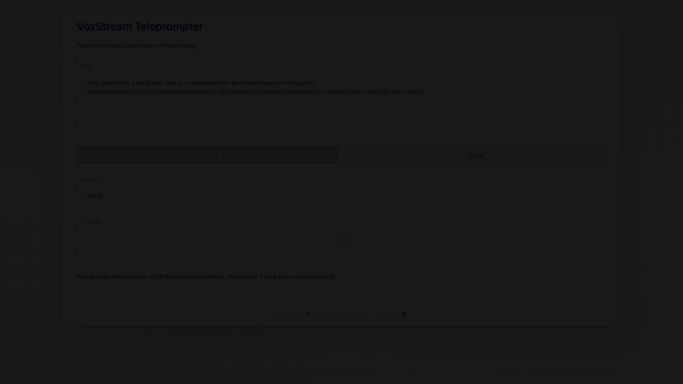
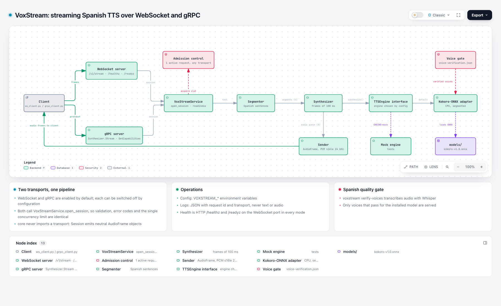

# VoxStream

Local Spanish text-to-speech streaming service. Clients stream text over a WebSocket or gRPC and
receive PCM audio frames while the text is still arriving. The engine is Kokoro-ONNX (CPU), behind a common
`TTSEngine` interface.

## Demo



Gradio teleprompter: type Spanish text, press Start, and each word is highlighted as it is spoken.
The GIF has no sound; the full-quality video is [`demo-video/voxstream/out/demo.mp4`](demo-video/voxstream/out/demo.mp4).

## Architecture



Interactive version: [`docs/architecture.html`](docs/architecture.html) (open in a browser).
Text goes through either transport (WebSocket or gRPC, both enabled by default) into one shared
service (admission, readiness, voice gate) and a per-request pipeline (segmenter, synthesizer,
sender) with bounded queues; the synthesizer talks only to the `TTSEngine` interface, so Kokoro and the mock
engine are interchangeable. The voice gate only exposes voices that passed Spanish verification.

## Installation

Requires macOS on Apple Silicon and [`uv`](https://docs.astral.sh/uv/). Python 3.12 is installed by `uv`.

```bash
uv sync --extra verify            # add --extra verify only if you will run voice verification
uv run voxstream download-models  # kokoro-v1.0.onnx + voices-v1.0.bin into models/ (~350 MB)
uv run voxstream verify-voices    # writes verification/voice-verification.json
uv run voxstream verify-voices --signoff ef_dora   # after listening to the voice once
```

## Supported versions
Tested on macOS 26.2 (Apple M2 Pro, 16 GB), Python 3.12.11, `kokoro-onnx` 0.6.1,
`onnxruntime` 1.31.0, `grpcio` 1.84.0, `grpcio-tools` 1.84.0, `protobuf` 7.36.2 (resolved in `uv.lock`;
the committed stubs were generated with protobuf 7.35.1 and `protobuf` is constrained to `>=7.35.1,<8`).
gRPC was tested on macOS arm64 with Python 3.12. Other platforms and Python versions are untested.

## Configuration
Environment variables (prefix `VOXSTREAM_`, optional `.env`):

| Variable | Default | Meaning |
|----------|---------|---------|
| `HOST` / `PORT` | `127.0.0.1` / `8765` | Bind address (shared by both transports); non-loopback needs `ALLOW_NON_LOCAL_BIND=true`. `PORT` serves WebSocket and the HTTP health endpoints |
| `ENABLE_WEBSOCKET` | `true` | Serve the WebSocket transport |
| `ENABLE_GRPC` | `true` | Serve the gRPC transport (at least one transport must be enabled) |
| `GRPC_PORT` | `50051` | gRPC port (plaintext, local only) |
| `ENGINE` | `kokoro` | `kokoro`, `vibevoice` (WebSocket only) or `mock` |
| `VIBEVOICE_MODEL_DIR` / `VIBEVOICE_DEVICE` | `models/vibevoice` / `cpu` | VibeVoice files; `cpu` or `mps` (an unavailable device is an error, never a silent fallback) |
| `MAX_TEXT_CHARS` | `2000` | Total characters per request |
| `REQUEST_TIMEOUT_S` / `IDLE_TIMEOUT_S` | `120` / `15` | Request and idle timeouts |
| `MAX_CONCURRENT_REQUESTS` | `1` | Service-wide active requests |
| `FRAME_MS` | `100` | Audio frame duration |
| `AUDIO_QUEUE_FRAMES` | `8` | Buffered frames before synthesis pauses |
| `MAX_PENDING_CHARS` | `120` | Fallback segment cut length |
| `EXECUTION_PROVIDER` | `cpu` | `cpu` or `coreml` (CPU recommended) |
| `MODELS_DIR` | `models` | Model files location |
| `VERIFICATION_FILE` | `verification/voice-verification.json` | Voice gate file |
| `DEFAULT_VOICE` | first verified | Voice used when the client omits one |

## Running
```bash
uv run voxstream serve
# prints: voxstream WebSocket ws://127.0.0.1:8765/v1/stream  and  voxstream gRPC 127.0.0.1:50051
curl http://127.0.0.1:8765/readyz
uv run python examples/ws_client.py --simulate-llm "Hola, soy tu asistente."
uv run python examples/grpc_client.py --simulate-llm "Hola, soy tu asistente."
```

Single transport: `VOXSTREAM_ENABLE_WEBSOCKET=false uv run voxstream serve` (gRPC only) or
`VOXSTREAM_ENABLE_GRPC=false uv run voxstream serve` (WebSocket only). Health is plain HTTP on
`PORT` (`/healthz`, `/readyz`) in every mode; there is no gRPC health service. Both transports share
one engine and one concurrency limit, so a request on one makes the other answer `BUSY`.

## Examples

Start the server first (`uv run voxstream serve`), then in another terminal:

```bash
# 1. Simulate an LLM: send the text in small pieces with short pauses; audio starts before the end
uv run python examples/ws_client.py --simulate-llm \
  "Hola, soy tu asistente. Hoy hace un buen día para aprender algo nuevo."

# 2. Send the whole text at once and choose a verified voice
uv run python examples/ws_client.py --voice em_alex --output alex.wav \
  "Mañana iremos a la montaña con el niño."

# 3. Cancel after 3 audio frames (prints a `cancelled` message)
uv run python examples/ws_client.py --cancel-after-chunks 3 \
  "Esta es una frase muy larga. Y otra frase larga también. Y una más."

# 4. Ask for an unavailable voice: prints the UNSUPPORTED_VOICE error
uv run python examples/ws_client.py --voice af_heart "Hello"

# 5. Health and readiness
curl http://127.0.0.1:8765/healthz
curl http://127.0.0.1:8765/readyz
```

The same flags work with `examples/grpc_client.py` (plus `--host` and `--port`, default
`127.0.0.1:50051`):

```bash
uv run python examples/grpc_client.py --simulate-llm \
  "Hola, soy tu asistente. Hoy hace un buen día para aprender algo nuevo."
uv run python examples/grpc_client.py --cancel-after-chunks 3 \
  "Esta es una frase muy larga. Y otra frase larga también. Y una más."
uv run python examples/grpc_client.py --voice af_heart "Hello"   # UNSUPPORTED_VOICE
```

Each run writes `out.wav` (or `--output`) and prints the time to first audio and the `completed`
message. A minimal client in Python:

```python
import asyncio, json, websockets

async def main():
    async with websockets.connect("ws://127.0.0.1:8765/v1/stream") as ws:
        await ws.send(json.dumps({"type": "start", "voice": "ef_dora"}))
        rid = json.loads(await ws.recv())["request_id"]
        for piece in ["Hola, ", "¿cómo estás? ", "Me alegra verte."]:
            await ws.send(json.dumps({"type": "text", "request_id": rid, "text": piece}))
        await ws.send(json.dumps({"type": "end", "request_id": rid}))
        async for msg in ws:
            if isinstance(msg, bytes):
                pass  # 21-byte header + PCM s16le 24 kHz mono
            elif json.loads(msg)["type"] in ("completed", "cancelled", "error"):
                break

asyncio.run(main())
```

## gRPC tutorial (Python, step by step)

The gRPC transport does the same job as the WebSocket one: you send Spanish text in pieces and
receive audio while the text is still arriving. Messages are protobuf instead of JSON, and audio
arrives as `AudioChunk` messages instead of binary frames.

**1. Install and start the service** (once; see [Installation](#installation))

```bash
uv sync
uv run voxstream download-models
uv run voxstream serve
# voxstream gRPC 127.0.0.1:50051
```

Leave it running. To serve gRPC only: `VOXSTREAM_ENABLE_WEBSOCKET=false uv run voxstream serve`.

**2. Try the ready-made client** (in another terminal)

```bash
uv run python examples/grpc_client.py --simulate-llm "Hola, soy tu asistente."
afplay out.wav    # macOS; the file is written when the request finishes
```

It prints the time to first audio and the `Completed` summary.

**3. Know the call shape.** One `Stream` call is one request, and events must go in this order:

| Direction | Message | Meaning |
|-----------|---------|---------|
| client → server | `Start(voice?)` | Open the request. Omit `voice` to use the default. |
| server → client | `Started` | Carries `request_id` and the audio format (`pcm_s16le`, 24000 Hz, mono). |
| client → server | `Text(text)` (repeat) | Send text pieces as they are produced. |
| client → server | `End` | No more text. |
| server → client | `AudioChunk` (repeat) | `pcm` bytes plus `sequence` and `last`. |
| server → client | `Completed` / `Cancelled` / `Error` | Exactly one, then the call ends with status OK. |

A client can send `Cancel` at any time to stop the audio. Errors, including a rejected `Start`, arrive
as an `Error` event, not as a gRPC status. The full contract is in
[docs/grpc-protocol.md](docs/grpc-protocol.md).

**4. Write your own client.** Save this as `my_client.py` in the repository root and run it with
`uv run python my_client.py`:

```python
import asyncio
import wave

from grpc import aio

from voxstream.transports.grpc.gen import voxstream_pb2 as pb
from voxstream.transports.grpc.gen import voxstream_pb2_grpc as pb_grpc


async def requests():
    yield pb.ClientEvent(start=pb.Start(voice="ef_dora"))
    for piece in ["Hola, ", "¿cómo estás? ", "Me alegra verte."]:
        yield pb.ClientEvent(text=pb.Text(text=piece))
    yield pb.ClientEvent(end=pb.End())


async def main():
    pcm = bytearray()
    async with aio.insecure_channel("127.0.0.1:50051") as channel:
        stub = pb_grpc.SynthesizerStub(channel)
        async for event in stub.Stream(requests()):
            kind = event.WhichOneof("event")
            if kind == "started":
                print("voz:", event.started.stream.voice)
            elif kind == "audio":
                pcm += event.audio.pcm  # PCM s16le, 24 kHz, mono
            elif kind == "completed":
                print("listo:", event.completed.audio_ms, "ms de audio")
            elif kind == "error":
                print("error:", event.error.code, event.error.message)
    with wave.open("minimal.wav", "wb") as w:
        w.setnchannels(1)
        w.setsampwidth(2)
        w.setframerate(24000)
        w.writeframes(bytes(pcm))


asyncio.run(main())
```

Then `afplay minimal.wav`. The request generator is what makes it streaming: replace the list of
pieces with text from your LLM and each `yield` goes out as soon as you produce it.

**5. Cancel, errors and capabilities**

- Cancel: yield `pb.ClientEvent(cancel=pb.Cancel())` (see `--cancel-after-chunks` in
  `examples/grpc_client.py`). You get one `Cancelled` event and audio stops within 500 ms.
- Unsupported voice or language: the call returns an `Error` event with `code` such as
  `UNSUPPORTED_VOICE` and no `request_id`.
- Another request is already running: `Error` with `code` `BUSY` (the limit is shared with WebSocket).
- Capabilities: `await stub.GetCapabilities(pb.CapabilitiesRequest())` lists engine, languages and
  voices.

The channel is plaintext and meant for localhost; there is no TLS or authentication yet.

## Demo (Gradio teleprompter)

A browser demo that speaks text through the running service and highlights the words as they are
heard. It is a pure client of the WebSocket protocol; the service is unchanged.

Prerequisites: the service running (`uv run voxstream serve`), `ffmpeg` (`brew install ffmpeg`,
used by Gradio's streaming audio), and the optional extra.

```bash
uv run --extra demo python -m demo.app     # then open http://127.0.0.1:7860
```

| Variable | Default | Meaning |
|----------|---------|---------|
| `DEMO_SERVICE_URL` | `ws://127.0.0.1:8765/v1/stream` | Service endpoint |
| `DEMO_HOST` / `DEMO_PORT` | `127.0.0.1` / `7860` | Demo bind (loopback only) |
| `DEMO_MAX_TEXT_CHARS` | `2000` | Over-length check; keep equal to `VOXSTREAM_MAX_TEXT_CHARS` |
| `DEMO_PLAYBACK_LEAD_MS` | `0` | Shift the highlight earlier (+) or later (−) to match what you hear |
| `DEMO_PREBUFFER_MS` | `0` | Hold this much audio before playing; raise (e.g. `4000`) for VibeVoice, which is slower than real time, to avoid choppy playback at the cost of a longer "Preparing speech…" |

The demo reads `/readyz` and shows the active engine (Kokoro or VibeVoice), a voice dropdown with
the Spanish voices the service offers, and a "Speaking with <engine> · <voice>" line. The engine
selector is read-only: to compare engines, restart the service with `VOXSTREAM_ENGINE=kokoro` or
`VOXSTREAM_ENGINE=vibevoice` and press **Refresh**. VibeVoice takes longer to produce its first
audio; the status shows "Preparing speech…" until it arrives.
| `DEMO_SPEECH_RATE_CHARS_PER_S` | `14` | Initial speech-rate estimate for word timing |

Troubleshooting: *no audio* — check ffmpeg is installed and click the player's play button if the
browser blocked autoplay; *"Can't reach the VoxStream service"* — start the service or fix
`DEMO_SERVICE_URL`. The highlighted position is **estimated** (the protocol carries no word timing):
it follows elapsed playback time and is rescaled to the real audio length when synthesis completes.

## VibeVoice (experimental, WebSocket only)
Second engine: Microsoft [VibeVoice-Realtime-0.5B](https://huggingface.co/microsoft/VibeVoice-Realtime-0.5B)
(MIT). Its model card lists English as the trained language and Spanish only as "experimental"
voice presets, so Spanish is **unproven until verified here**.

```bash
uv sync --extra vibevoice --extra verify
uv run voxstream download-models --engine vibevoice     # about 2 GB + 4 Spanish presets
VOXSTREAM_VIBEVOICE_DEVICE=mps uv run voxstream verify-voices --engine vibevoice
VOXSTREAM_ENGINE=vibevoice VOXSTREAM_ENABLE_GRPC=false VOXSTREAM_VIBEVOICE_DEVICE=mps \
  uv run voxstream serve
```

- **Verification result (2026-10-10, `verification/vibevoice-verification.json`)**: `sp-Spk4_woman`
  (mean WER 0.053) and `sp-Spk5_man` (0.008) pass; `sp-Spk2_woman` (0.273, one sentence at 1.0) and
  `sp-Spk3_man` (0.030 mean, worst sentence 0.364 against the 0.35 limit) fail. Only passing voices
  are served. Manual listening sign-off recorded 2026-10-10 for both passing voices (accent not documented upstream; judged acceptable by ear)
  If none pass, the engine answers
  `ENGINE_UNAVAILABLE`.
- **gRPC is not supported** for this engine (a documented exception to the transport-parity principle; see `specs/004-vibevoice-websocket-engine/plan.md`, Complexity Tracking). With gRPC enabled the service refuses to start:
  `engine 'vibevoice' is not supported on the gRPC transport; set VOXSTREAM_ENABLE_GRPC=false.`
- **Streaming mode** `incremental` (audio is produced while the model generates), 24 kHz mono.
- **Cost**: about 7.8 GB resident, and generation is about 1.9 times slower than real time on an M2
  Pro with `mps` (about 9 times slower than real time on `cpu`, the default), so long text will underrun playback. Suitability: usable on a 16 GB Apple Silicon machine with little else running; **not suitable for machines with 8 GB** or for long live narration. Numbers and the
  Kokoro comparison: `docs/measurements.md`.
- **Install notes**: `torch` is pinned to 2.7.1 (newer versions cannot load the voice presets with
  `weights_only=True`, which is kept on because the presets are pickles). The upstream `vibevoice`
  package is installed from its GitHub repository. `download-models --engine vibevoice` checks the
  voice presets against pinned sha256 values (trust on first use, pinned 2026-10-10) and rejects a
  mismatch.

## Protocol
**WebSocket** at `ws://127.0.0.1:8765/v1/stream`: JSON text frames for control (`start`, `text`, `end`,
`cancel`, `capabilities`; replies `started`, `completed`, `cancelled`, `error`) and binary frames for
audio (16-byte request id, uint32 sequence, flags, PCM s16le 24 kHz mono). Full contract:
[`specs/001-kokoro-websocket-streaming/contracts/`](specs/001-kokoro-websocket-streaming/contracts/).

**gRPC** at `127.0.0.1:50051` (plaintext, local only): service `voxstream.v1.Synthesizer` with a
bidirectional `Stream` call (one request per call) and a unary `GetCapabilities`. Same audio format,
error codes, limits and cancellation as WebSocket; errors are events inside the stream and the call
ends with status `OK`. Schema: [`proto/voxstream/v1/voxstream.proto`](proto/voxstream/v1/voxstream.proto);
contract and message-by-message mapping to WebSocket: [`docs/grpc-protocol.md`](docs/grpc-protocol.md).
After editing the `.proto`, regenerate the committed stubs with `scripts/gen_proto.sh`.

## Troubleshooting
- **`/readyz` returns 503**: the reason is in the JSON body. Missing models: run `download-models`.
  No verified voice: run `verify-voices`; re-run it if the model file changed.
- **First request is slow (~1.5 s)**: the model loads lazily on the first request.
- **espeak errors**: the phonemizer library ships with `espeakng-loader`; reinstall with `uv sync`.
- **Out of memory (`OUT_OF_MEMORY`)**: close other applications; typical use is about 0.6 GB for Kokoro and about 7.8 GB for VibeVoice.
- **`BUSY`**: only one request runs at a time; retry after the active one ends.

## Tested versus planned
- Tested: WebSocket and gRPC streaming, cancel, errors, backpressure, voice verification and health
  checks, with the mock engine (default test run, one contract suite for both transports) and
  Kokoro (`pytest -m model`).
- Experimental: Core ML provider (works, not faster; see `docs/decisions.md`), the int8 model
  (needs its own verification).
- Planned, not built: gRPC TLS and authentication, the formal transport benchmark, other engines
  beyond Kokoro and VibeVoice. Local-loopback numbers for both transports are in `docs/measurements.md`.

## Development
`scripts/check.sh` runs ruff, mypy and the default tests. Measurements: `docs/measurements.md`.
